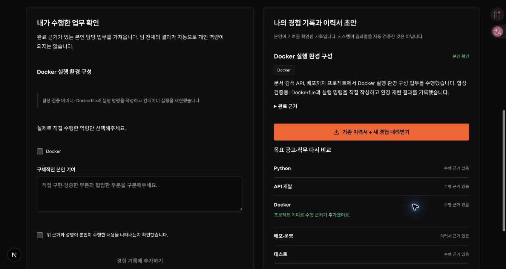

# CareerFlow × ProjectMate 통합 파이프라인

> 이 문서는 1차 역량·프로젝트 연결 구현 기록이다. 2026-10-08 화면 통합과 20개 템플릿, 솔로 규칙, 포트폴리오·공고·성장 기록, 실행 안내는 [현재 통합 앱 문서](unified-app.md)가 우선한다. 아래 `/career`는 현재 `/app`으로 이동하며, 5개 템플릿·최소 2명 규칙은 1차 구현 설명이다.

## 이번 구현의 범위

`web/`의 `/career`에서 동일한 Google 계정·Postgres DB·프로젝트 권한을 사용한다. 기존 Python CareerFlow(`careerflow/`)와 원본 개인 저장소는 변경하지 않았다. Python 앱의 SQLite 이력서를 자동 이전하지 않으므로 `/career`에서 다시 입력한다.

```text
PDF/TXT 또는 이력서 본문 + 목표 직무/공고 + 성장 목표
  → 원문 근거가 있는 개인 역량 프로필(불변 버전)
  → 수행 근거 / 일부 근거 / 근거 없음 / 본인 확인 미경험
  → 강점 활용형·성장 도전형 프로젝트 추천
  → 목표·범위·완료 기준 확인 → 준비 중 프로젝트 생성
  → 기존 초대·목표 합의 + 각 팀원의 선택적 역량 공유
  → 팀 전체 역할안 → 팀장 검토·담당자 수정·승인
  → 실제 ProjectMate 업무·의존관계·예상 공수
  → 본인 업무 완료 근거 + 본인 기여·수행 역량 확인
  → 경험 문장·역량 근거 갱신 → 다음 프로젝트 추천
```

역할 자동 추천은 **수행 역할**(AI, 백엔드, 프론트엔드, 데이터, 기획, 배포·품질)을 제안한다. 서비스의 **권한**(팀장/팀원)은 바꾸지 않는다. 생성 즉시 스프린트를 시작하지 않는다. 기존의 2~4인·전원 목표 합의·팀장 시작 후 7일 고정 규칙을 유지한다.

## 화면 사용 순서

1. **나의 역량**: PDF/TXT를 읽거나 본문을 입력한다. 목표 공고가 없으면 직무별 학습 참고 기준과 비교한다. 성장 목표와 희망 역할을 선택하고 저장한다.
2. **프로젝트 추천**: 활용 가능한 경험, 보완 가능한 경험, 추천 참여 역할을 확인한다. 목표·과제·공수를 검토하고 새 프로젝트를 만든다.
3. **팀 역할·과제**: 기존 작업 공간에서 팀원을 초대한다. 각자는 공개할 역량만 직접 선택한다. 팀 전체의 공유 경험·희망·기존 업무량으로 역할안을 만들고 팀장이 검토한 뒤 반영한다.
4. **기존 업무 화면**: 생성된 실제 업무에 체크인·완료 근거를 남긴다. 재추천을 적용해도 같은 템플릿 업무는 중복 생성하지 않으며 완료 업무는 재배정하지 않는다.
5. **경험 기록**: 선택한 프로젝트의 본인 완료 업무에서 실제 수행 역량과 기여를 확인해 가져온다. 목표 대비 전후 변화를 보고 기존 이력서에 경험 문장을 더한 TXT를 내려받는다.

이력서에 없는 역량을 곧바로 ‘능력 없음’으로 판단하지 않는다. 학습·언급과 실제 수행 근거를 구분한다. 문서에 쓰인 근거 자체가 사실임을 시스템이 독립적으로 검증하는 것은 아니다.

## 분석·추천 방식

- 기본 추출: 외부 전송 없이 서버의 키워드·문장 규칙으로 추출한다. AI 분석이나 숙련도 점수로 표시하지 않는다.
- AI 추출: 서버 키와 사용자 동의가 있을 때만 OpenAI Responses API를 호출한다. JSON Schema 구조화 출력, 원문 인용 일치, 알려진 역량 ID를 검증한다. 오류를 기본 추출 결과로 위장하지 않는다.
- AI 모델 선택: `CAREERFLOW_MODEL` → `PROJECTMATE_MODEL` → 기존 서비스 기본값 `gpt-6.1-sol`. 실제 계정에서 사용 가능한 모델 이름으로 설정한다. 이번 검증에서는 유료 모델을 호출하지 않았다.
- 이력서 AI 호출 한도: KST 기준 계정당 하루 10회. 기존 회의록 AI 한도와 별도이며 모델 호출 실패는 사용 횟수를 복구한다.
- 프로젝트 추천: 현재는 18개 역량과 직접 작성한 5개 학습 템플릿의 규칙 기반 비교다. 실제 모집 중인 팀을 검색하거나 채용을 중개하는 기능이 아니다.
- 팀 역할 추천: 최대 4명의 조합을 비교해 공유 근거·희망 역할·업무량을 함께 반영한다. 경험을 공유하지 않은 사람의 능력을 추정하지 않는다. 성장 목표가 실제 배정 업무에 포함되지 않으면 경고한다.
- 희망 역할이 자동으로 최종 확정되지 않는다. 담당자 수정 시 기존 추천 근거는 최초 추천자 기준임을 표시한다. 협업/멘토링 담당자를 따로 관리하는 기능은 아직 없다.

AI 출력 검증은 [OpenAI Structured Outputs 문서](https://developers.openai.com/api/docs/guides/structured-outputs?api-mode=responses)를 참고했다. 구조가 맞는다는 것과 분석이 정확하다는 것은 다르므로 사용자 검토를 유지한다.

## 개인정보·일관성 경계

- PDF 원본은 브라우저에서만 처리한다. 저장하는 것은 사용자가 확인한 텍스트와 분석 결과다. 최대 5MB·30쪽·40,000자, TXT 지원. 암호화·스캔 PDF는 직접 입력 안내; OCR 미구현.
- 이력서 원문·파일명·공고 본문·근거 인용은 개인 계정에만 반환한다. 팀에는 직접 선택한 역량/경험 구분·성장 목표·희망 역할만 전달한다.
- 팀 공유는 프로필 수정과 별개의 명시적 작업이다. 프로필이 바뀌면 팀에는 이전 공유 버전임을 표시하고 갱신을 요청한다. 공유 철회 시 오래된 역할안도 숨기고 반영을 차단한다.
- 프로젝트 경험은 완료 상태·업무 버전·담당자·근거·현재 참여가 유지될 때만 현재 역량으로 인정한다. 원본 업무가 재개/변경되면 개인 추천과 다른 프로젝트에 공유한 해당 경험을 제외하고 그 근거에 의존한 역할안을 무효화한다.
- AI는 DB를 직접 수정하지 않는다. 역할 반영은 기존 트랜잭션·프로젝트 revision·저장 시점 권한 검사를 통과한다. 오래된 제안/중복 승인/동시 변경을 거절한다.
- 8개 새 테이블은 모두 RLS ON이며 인증된 서버 라우트만 접근한다. 서버 키는 브라우저 번들에 포함하지 않는다. 이력서·모델 원문·DB 파라미터를 새 API의 오류 로그에 남기지 않는다.
- 개인 프로필은 버전 이력을 보존한다. **개인 데이터 삭제·보존기간 관리 UI는 미구현**이므로 외부 사용자 대상 출시 전에 삭제/보관 정책과 기능을 추가해야 한다. `store:false`는 모델 응답 저장 옵션이지 모든 제공자 보관을 없앤다는 보장이 아니다.

## 주요 파일

| 파일 | 담당 |
|---|---|
| `web/app/career/`, `web/components/career-workspace.tsx` | 통합 화면 |
| `web/app/api/career/route.ts` | 인증·입력·AI 동의/한도·개인/팀 API |
| `web/lib/career/catalog.ts` | 역량 사전·직무 참고 기준·프로젝트/과제 템플릿 |
| `web/lib/career/profile.ts`, `model.ts`, `pdf.ts` | 근거 추출·갭·프로젝트 추천·AI·파일 읽기 |
| `web/lib/career/roles.ts`, `store.ts` | 팀 역할 최적화·공유·실제 업무 생성·경험 연결 |
| `web/db/migrations/0005_career_growth.sql` | 개인/팀/과제/경험/AI 한도 8개 테이블 |
| `web/tests/career.test.mjs` | 실제 PGlite SQL과 기존 프로젝트 API를 잇는 통합 테스트 |

`GET /api/career`는 개인 프로필·역량·추천·경험을, `GET /api/career?project=ID`는 멤버십 검사 후 공유 정보·역할안·연결 업무를 반환한다. POST action은 `profile`, `createProject`, `share`, `unshare`, `recommendRoles`, `applyRoles`, `recordExperience`. 프로젝트 쓰기는 현재 `revision`, 역할 반영은 `proposalId` 및 `approved:true`, 경험 가져오기는 `taskVersion` 및 `confirmed:true`가 필요하다.

## 로컬 실행

아래는 `web/`에서 실행한다. 기존 서버를 끈 뒤 마이그레이션한다. `.env.local`에 운영 DB나 메일 설정이 있으면 이 테스트에 사용하지 않는다.

```sh
npm ci
env -u DATABASE_URL DATABASE_PATH=.data/career-preview npm run db:migrate
env -u DATABASE_URL -u OPENAI_API_KEY -u EMAIL_PROVIDER -u EMAIL_FROM -u EMAIL_API_KEY -u SUPABASE_URL -u NEXT_PUBLIC_SUPABASE_URL -u NEXT_PUBLIC_SUPABASE_ANON_KEY DATABASE_PATH=.data/career-preview npm run dev -- --webpack --port 3276
```

별도 터미널에서 합성 계정 전용 로컬 프록시를 띄운다(개발 모드에서만 동작, 실제 사용자 로그인이 아님).

```sh
node scripts/dev-as.mjs 3277 career-preview-owner 가상지원자 3276
node scripts/dev-as.mjs 3278 career-preview-mate 가상팀원 3276
```

`http://127.0.0.1:3277/career`, `http://127.0.0.1:3278/career`에서 확인한다. 초대 테스트 이메일은 `career-preview-mate@test.local`; 메일 설정이 없는 로컬에서 생성한 링크로 수락한다. `web/tests/fixtures/career-resume.pdf`는 파일 읽기용 합성 텍스트 PDF다. 개인 이력서가 아니다.

PGlite는 서버 번들링에서 제외한다(`serverExternalPackages`). 그렇지 않으면 Webpack에서 WASM 파일 URL 해석이 실패한다. Next route 파일에서 허용되지 않는 테스트용 `useModel` export는 `lib/ai-model-selection.ts`로 이동했고 기존 회의록 테스트의 주입 지점도 함께 옮겼다.

## 배포 전 주의

작업 브랜치: `codex/career-growth-pipeline`. 운영 GitHub main·phs, 운영 DB에는 반영하지 않았다. 이 저장소는 main=운영, 브랜치/PR=미리보기이고 DB를 공유하는 구성이다. **push/PR/merge 전에 운영 DB 분리 여부와 마이그레이션 적용 대상을 확인**해야 한다. 이번 변경은 추가 테이블이지만 마이그레이션을 자동 실행하지 않는다.

원격 확인 시점(2026-10-07): main과 phs는 `e2f1316`, 기존 `codex/careerflow-integration`은 `22b008d`. 이번 작업은 그 시점 main에서 분기했다. 원격 브랜치를 강제로 합치거나 덮어쓰지 않았다.

## 검증과 남은 범위

자동 검증은 합성 이력서·모델 응답과 격리 PGlite를 사용한다. 실제 AI 정확도, Google 다중 계정 운영 협업, Supabase/Vercel 신규 기능 배포는 별도 검증 대상이다. 실행 결과와 브라우저 확인 내역은 이 문서 하단에 기록한다.

후속 확장: 실제 모집 프로젝트 카탈로그, 멘토/성장 담당 공동 배정, 코드·PR 등 기여 근거 연결(별도 동의), 완료 후 회고 질문, 데이터 삭제/보관 관리, 기존 Python 이력서의 사용자 선택 이전.

### 2026-10-07 검증 결과

- `npm test`: 246개 전부 통과. 새 커리어 통합 12개와 기존 234개. 실제 모델은 합성 응답으로 검증했다.
- `npm run build -- --webpack`: 프로덕션 컴파일·타입 검사·페이지 생성 통과. `/career`, `/api/career` 포함.
- 빌드 완료 후 별도로 `npx tsc --noEmit`, 변경 서비스 코드 대상 `npx oxlint`, `git diff --check` 통과. 타입 검사와 빌드는 같은 `.next/types`를 사용하므로 동시에 실행하지 않는다.
- 기본 Turbopack 빌드는 이 실행 환경의 내부 포트 생성 제한(`Operation not permitted`)으로 실패했다. Webpack으로 실제 빌드를 완료했으며 배포 환경의 기본 빌드는 별도 확인한다.
- 격리 `.data/career-preview`에 `0000`~`0005` 마이그레이션 적용. 운영 DB 미접속.
- Chrome + 로컬 합성 계정 2개: 이력서 저장 → 근거·갭 → 추천 → 프로젝트 생성 → 초대/수락 → 선택 공유 → 역할안 수정/승인 → 기존 작업 공간에 실제 업무 5개 생성 확인.
- 기존 업무 UI에서 Docker 업무 완료 근거 저장 → 경험 기록에서 본인 수행 역량/기여 확인 → 이력서 문장 생성 및 Docker `근거 없음 → 수행 근거 있음` 확인.
- 새로고침 후 프로필·공유 선택·역할 업무 재조회 확인. 공유 체크박스가 저장된 선택을 복원하도록 수정했다.
- 합성 텍스트 PDF의 실제 브라우저 추출과 worker 로딩 확인(콘솔 오류 없음). 확장 파일 접근 설정은 변경하지 않았으며 일반 macOS 파일 선택창을 사용했다. 한글/스캔/복잡한 다단 PDF의 실제 파일 QA는 별도다.
- 완료 업무 재개 시 개인 경험과 다른 프로젝트에 공유된 동일 경험의 효력이 사라지고, 기존 역할안이 숨겨지며 적용이 거절되는 회귀 테스트 포함.


